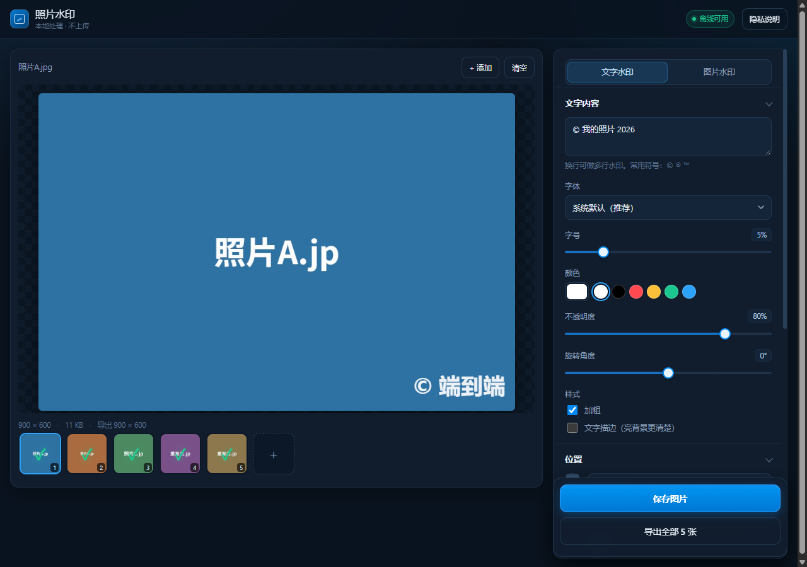

# 照片水印 · Photo Watermark

**在线使用：<https://zionbeihai.github.io/photo-watermark/>** ← 手机上直接打开这个地址

给照片添加文字水印、图片 Logo 水印、平铺水印的**纯前端 Web App（PWA）**。

- **免费**：无内购、无广告、无账号、无服务器成本（可托管在免费静态服务上）
- **安全**：照片全程在浏览器本地处理，**不上传任何服务器**，没有任何第三方请求
- **双端**：iOS Safari / Android Chrome 都能用，可"添加到主屏幕"，像 App 一样全屏启动
- **离线**：首次打开后缓存到本地，断网也能继续用



---

## 一、先跑起来

### 方式 A：本地预览（推荐用这个验证功能）

浏览器对 `file://` 有限制（Service Worker 不工作、部分 API 受限），所以要用一个静态服务器：

```bat
双击运行 start-server.bat
```

或者手动：

```bash
# 任选其一，在本目录下执行
python -m http.server 8000 --bind 127.0.0.1
npx serve .
```

然后打开 <http://127.0.0.1:8000/>。

> 注意：必须用 `http://127.0.0.1` 或 `http://localhost`，不能用局域网 IP，否则 Service Worker 不生效。

### 方式 B：部署到线上

**本项目已经部署完成：**

| 项 | 地址 |
|---|---|
| 线上地址（手机直接打开） | <https://zionbeihai.github.io/photo-watermark/> |
| 代码仓库 | <https://github.com/zionbeihai/photo-watermark> |

#### 以后怎么更新

改完代码后，在项目目录执行：

```bash
git add -A
git commit -m "说明这次改了什么"
git push
```

GitHub Pages 会在 1 分钟左右自动重新构建。

> **重要**：改了 `css/`、`js/`、`index.html` 之后，记得把 `sw.js` 里的 `VERSION` 改一下
> （例如 `v1.0.0` → `v1.0.1`），否则老用户会一直用缓存的旧版本。

#### 如果想部署到自己的域名

1. 在仓库 Settings → Pages → Custom domain 填入域名
2. 在域名服务商处添加 CNAME 记录指向 `<你的用户名>.github.io`
3. 勾选 Enforce HTTPS

---

## 二、手机上怎么装成 App

### iOS（Safari，必须用 Safari，不能用微信）

1. 用 Safari 打开部署好的网址
2. 点底部中间的 **分享** 按钮
3. 往下滑，选 **添加到主屏幕** → 添加
4. 桌面会出现「照片水印」图标，点开是全屏的，没有浏览器地址栏

**保存图片**：点「分享 / 存到相册」→ 系统分享面板 → **存储图像**，图片直接进相册。

### Android（Chrome / Edge）

1. 用 Chrome 打开网址
2. 右上角菜单 → **添加到主屏幕** / **安装应用**
3. 之后从桌面图标启动

**保存图片**：点「保存图片」，会存到「下载」目录；点「分享 / 存到相册」可以走系统面板存到相册。

> **微信 / QQ 内置浏览器**：对 Blob 下载和系统分享支持很差，点右上角「…」选择「在浏览器中打开」再用。

---

## 三、功能

### 文字水印

| 参数 | 说明 |
|---|---|
| 内容 | 支持多行（换行即多行水印），中英文均可 |
| 字体 | 系统默认 / 衬线 / 黑体 / 等宽 / 楷体 / 圆体（取决于设备已装字体） |
| 字号 | 相对图片短边的百分比，所以换任何分辨率比例都对 |
| 颜色 | 取色器 + 6 个常用色 |
| 不透明度 | 5%~100% |
| 旋转 | -90°~90° |
| 描边 | 可选，亮背景上的白字加一圈深色描边更清楚 |
| 位置 | 九宫格 9 个位置 + 边距 |
| 平铺 | 整图重复铺满，可调间距和平铺角度（防盗图常用） |

### 图片 / Logo 水印

上传 PNG/JPG/WEBP/SVG，可调大小、不透明度、旋转，共用九宫格定位和平铺。

> 顶部是三段开关：**无水印 / 文字 / 图片**。
> 选「无水印」时不叠加任何水印，只做换底色等处理，导出文件名后缀变成 `-edited`；
> 同一时间只能启用一种水印。

### 批量

一次最多 30 张，缩略图条可切换当前编辑的照片。点「导出全部」：

- 手机上优先唤起系统分享面板（可一次存多张到相册）
- 分享不可用 / 桌面端 → 打包成一个 ZIP 下载
- **同名文件会自动加序号**（`IMG_1.jpg` 和 `IMG_1-2.jpg`），不会互相覆盖

### 证件照换底色

自动识别纯色背景，替换成常见证件照底色，适合蓝底换白底、白底换蓝底这类场景。

| 预设 | 色值 |
|---|---|
| 标准蓝 | `#438EDB` |
| 深蓝 | `#2A5CAA` |
| 浅蓝 | `#A6C9EC` |
| 白 | `#FFFFFF` |
| 标准红 | `#D9001B` |
| 深红 | `#A50D1F` |
| 浅灰 | `#D9D9D9` |

也可以点取色器自定义任意颜色。

| 参数 | 说明 |
|---|---|
| 容差 | 背景识别阈值。背景没换干净就调大，人像被误删就调小 |
| 边缘羽化 | 头发、肩膀边缘的过渡柔和度，数值越大越自然 |

**实现原理**（纯浏览器端，无 AI 模型）：

1. 从图片四条边采样，用每通道的直方图**中位数**估计原底色（比平均值抗阴影）
2. 逐像素计算与底色的 RGB 欧氏距离
3. 距离 < 容差 → 判为背景，替换成目标色
4. 距离 > 容差 + 羽化 → 判为前景，保留原样
5. 中间区间 → 线性混合，避免头发边缘出现硬锯齿

**局限（必须了解）**：只适用于纯色或接近纯色的背景。背景有花纹、杂物、明暗渐变时无法干净分离；如果衣服颜色与背景很接近（白衬衫 + 白底），也会被一起替换。

这类情况需要 AI 人像分割模型（4~5MB），本应用为了保持"零依赖、离线秒开"没有引入。

**换底后的水印对比度**：换白底后，原来的白色水印会看不见。界面会自动检测并在面板里给出"自动调整"按钮，一键把水印换成深色 + 白色描边。

### 导出

| 选项 | 说明 |
|---|---|
| 格式 | JPG（体积小）/ PNG（无损） |
| 画质 | JPG 50~100 |
| 最大边长 | 原始 / 4096 / 2560 / 1600 / 1080 |
| EXIF | **清除**（默认）或 **保留** |

**默认清除 EXIF**：手机照片常带拍摄时间、机型、GPS 坐标，公开发布前清掉更安全。

选择"保留"时：
- 会把原图的 EXIF 写回导出的 JPEG
- 自动把 Orientation 归一化为 1（因为画布里的图像已经转正，否则查看器会再转一次导致方向错乱）
- 会**保留 GPS 位置**，需要自己判断是否外发
- PNG 格式不支持嵌入 EXIF，选 PNG 时会自动按清除处理

---

## 四、安全性说明（重要，请如实理解）

### 技术上如何保证照片不上传

1. 本应用是**纯静态文件**，没有后端、没有数据库、没有接口
2. 照片通过浏览器本地 API 处理：`<input type=file>` → `Image` 解码 → `<canvas>` 合成 → `canvas.toBlob()` 生成本地文件
3. 页面**不发起任何图片相关的网络请求**，不引入任何第三方脚本、字体、CDN
4. 全部处理逻辑就在 `js/` 目录里，可以自己审计

你可以自己验证：打开开发者工具 → Network 面板 → 添加照片并导出，除了首次加载本页自己的静态资源，**不会有任何网络请求**。

### 需要知道的边界

- 托管平台（GitHub Pages / Cloudflare）**会记录访问日志**（IP、时间、User-Agent）。它们拿不到你的照片，但知道"有人访问过这个页面"。
- 如果你把页面放到自己的服务器，安全边界取决于你自己的服务器配置。
- 生成的图片存在本地，**用完记得清理手机上的临时文件**（尤其是选了保留 EXIF 的）。

---

## 五、已知限制

| 限制 | 说明 |
|---|---|
| HEIC 照片 | 取决于浏览器。Safari 能解码，Chrome/Android 通常不能，会提示"无法解码" |
| 超大图 | iOS Safari 单张画布上限约 1600 万像素，超出会自动缩小导出并在界面提示 |
| 移动端内存 | 一次加载太多超大图会被限制并发解码；应用同一时刻只保留一张已解码位图 |
| 微信浏览器 | 下载/分享受限，建议"在浏览器中打开" |
| 平铺水印 | 极端参数（字号极大 + 间距极小）会自动限制绘制数量，避免卡死 |
| ZIP | 不压缩（STORE），3000 万像素以下的照片打包体积约为原图之和 |
| PDF/SVG 输入 | 不支持 |
| 换底色 | 只支持纯色/近似纯色背景；复杂背景需要 AI 抠图，未引入 |
| 换底色性能 | 2400 万像素图额外耗时约 300ms（桌面 Chrome 实测）；手机上更慢，批量导出会逐张处理 |

---

## 六、目录结构

```
photo-watermark/
├── index.html               页面结构
├── css/style.css            样式（无外部依赖）
├── js/
│   ├── watermark.js         水印绘制引擎（Canvas 2D，纯函数）
│   ├── bg.js                证件照换底（背景色估计 + 逐像素替换）
│   ├── exif.js              JPEG EXIF 读取 / 写回 / 方向归一化
│   ├── zip.js               批量导出的 ZIP 打包（STORE + CRC32）
│   └── app.js               应用状态、交互、导出流程
├── icons/                   PWA 图标（含 maskable）
├── sw.js                    Service Worker（离线缓存）
├── manifest.webmanifest     PWA 清单
├── start-server.bat         Windows 一键本地预览
├── tests/                   测试与验证脚本
├── scripts/build_icons.py   重新生成图标
└── README.md
```

### 核心设计：为什么预览和导出能一致

所有尺寸参数都以 **图片短边 `min(W,H)` 的百分比**存储（字号、边距、Logo 大小）。
预览用一张小画布，导出用原分辨率大画布，两者只是 `W/H` 不同，按同一套比例计算，视觉结果完全一致。

---

## 七、测试

`tests/` 下的脚本都是可以真跑的：

```bash
# EXIF 模块（需要 Node）
node tests/test-exif.js

# ZIP 模块（需要 Node）
node tests/test-zip.js

# 换底色算法（需要 Node）
node tests/test-bg.js

# 独立验证：用 Python 检查浏览器实际导出的 ZIP
python tests/verify-browser-zip.py
```

浏览器端的功能验证（水印位置、平铺覆盖、EXIF 方向、离线可用、大图性能）是通过 Playwright/CDP 注入脚本完成的，
断言包括"导出图右下角白色像素占比""平铺 3×3 网格每格都有水印""断网后页面仍能加载并导出"等，不是"看起来对"。

---

## 八、可选的后续方向

- 水印位置支持拖拽微调
- 文字 + Logo 同时叠加
- 从 EXIF 一键生成水印文字（拍摄时间 / 机型）
- 用 Capacitor 打成 Android APK 自行分发（核心逻辑不用改）
